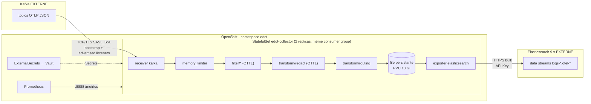

# EDOT Collector — ingestion de logs Kafka → Elasticsearch

Chaîne d'ingestion **autonome** (sans Fleet) qui consomme des logs **OTLP JSON**
dans un cluster **Kafka externe**, supprime des événements et des champs avec
**OTTL**, puis les indexe dans un cluster **Elasticsearch 9.x externe**.
EDOT (Elastic Distribution of OpenTelemetry) est déployé sur OpenShift avec le
**chart Helm officiel OpenTelemetry Collector**, géré par **Argo CD**.

> [!IMPORTANT]
> **État : développé et validé, NON déployé.** Les paramètres de connexion
> sont des `TODO_*` volontairement invalides : la configuration est refusée par
> EDOT tant qu'ils ne sont pas renseignés. Liste exhaustive :
> [`TODO.md`](TODO.md). Contrôle : `tests/preflight.sh`.

| | |
|---|---|
| Image | `docker.elastic.co/elastic-agent/elastic-otel-collector:9.5.6` (UBI 9, digest `sha256:9caf6481…c8ee0f1`) |
| Collector embarqué | OpenTelemetry Collector **v0.163.0** (core + contrib) |
| Chart | `open-telemetry/opentelemetry-collector` **0.178.3** |
| Application Argo CD | [`argocd/applications/infra/edot-collector.yaml`](../../argocd/applications/infra/edot-collector.yaml) — projet `infra`, **sync manuelle** |
| Namespace | `edot` |
| Déploiement | StatefulSet, 2 réplicas, 1 PVC de 10 Gi par réplica |

## Sommaire

1. [Architecture générale](#1-architecture-générale)
2. [Choix d'EDOT](#2-choix-dedot)
3. [Choix du chart Helm](#3-choix-du-chart-helm)
4. [Mode autonome](#4-mode-autonome)
5. [Spécificités OpenShift](#5-spécificités-openshift)
6. [Connexions aux clusters Kafka et Elasticsearch externes](#6-connexions-aux-clusters-kafka-et-elasticsearch-externes)
7. [Flux réseau](#7-flux-réseau)
8. [Ports à ouvrir](#8-ports-à-ouvrir)
9. [Certificats et sécurité Kafka](#9-certificats-et-sécurité-kafka)
10. [Gestion des secrets](#10-gestion-des-secrets)
11. [Consumer group](#11-consumer-group)
12. [Filtres et suppressions OTTL](#12-filtres-et-suppressions-ottl)
13. [Export Elasticsearch](#13-export-elasticsearch)
14. [PVC et file persistante](#14-pvc-et-file-persistante)
15. [Supervision Prometheus et Grafana](#15-supervision-prometheus-et-grafana)
16. [Déploiement Argo CD et mise en service](#16-déploiement-argo-cd-et-mise-en-service)
17. [Rollback](#17-rollback)
18. [Diagnostic et dépannage](#18-diagnostic-et-dépannage)
19. [Fiabilité de la collecte](#19-fiabilité-de-la-collecte)
20. [Validations et tests](#20-validations-et-tests)
21. [Mise à jour d'EDOT](#21-mise-à-jour-dedot)

---

## 1. Architecture générale



- EDOT **initie** toutes les connexions : il n'ouvre aucun port de réception, n'a
  ni Route, ni Ingress, ni LoadBalancer. Seul le port des métriques (8888) est
  exposé en ClusterIP pour Prometheus.
- Kafka et Elasticsearch sont joints par leurs **adresses externes** ; aucun
  Service Kubernetes (ni `ExternalName`) ne les représente.
- Rien n'est déployé côté Kafka ni Elasticsearch, aucune de leurs
  configurations n'est modifiée. Les pipelines Logstash existants ne sont pas touchés.

### Fichiers

| Fichier | Rôle |
|---|---|
| [`values.yaml`](values.yaml) | base : image, StatefulSet, PVC, ressources, probes, HA, références aux Secrets, télémétrie, câblage du pipeline |
| [`values-openshift.yaml`](values-openshift.yaml) | profil plateforme OpenShift (SCC `restricted-v2`) — **défaut** |
| [`values-kubernetes.yaml`](values-kubernetes.yaml) | profil Kubernetes standard (à la place du précédent) |
| [`values-kafka.yaml`](values-kafka.yaml) | receiver Kafka — **TODO** |
| [`values-elasticsearch.yaml`](values-elasticsearch.yaml) | exporter Elasticsearch, data stream — **TODO** |
| [`values-processing.yaml`](values-processing.yaml) | `memory_limiter`, **filtres** et **suppressions de champs** OTTL |
| [`kustomization.yaml`](kustomization.yaml) | ressources hors chart : ExternalSecrets, alertes, dashboard, NetworkPolicies |
| [`external-secrets/`](external-secrets/) | SecretStore Vault + ExternalSecrets (**générés** par `scripts/vault-secrets.py render`) |
| [`network-policies/`](network-policies/) | default deny + sorties Kafka / Elasticsearch (**TODO**) + DNS + scrape |
| [`prometheusrule.yaml`](prometheusrule.yaml) | 21 alertes |
| [`dashboards/edot-collector.json`](dashboards/edot-collector.json) | dashboard Grafana |
| [`tests/`](tests/) | validation statique, contrôle préalable, diagnostic réseau, banc fonctionnel |
| [`TODO.md`](TODO.md) | **tous** les paramètres à fournir avant la production |
| [`VALIDATION.md`](VALIDATION.md) | compte rendu des validations et tests réalisés, et de ceux non exécutés |

## 2. Choix d'EDOT

- **Distribution supportée par Elastic** de l'OpenTelemetry Collector : mêmes
  composants upstream (v0.163.0), testés avec Elasticsearch, support Elastic.
  Les composants utilisés sont au niveau *Core* ou *Extended* de la
  [liste Elastic](https://www.elastic.co/docs/reference/edot-collector/components)
  (`kafkareceiver`, `elasticsearchexporter`, `transformprocessor`, `filestorage` :
  Core ; `filterprocessor`, `memorylimiterprocessor`, `healthcheckextension` : Extended).
- **Exporter Elasticsearch** avec le mapping natif OpenTelemetry (`mapping.mode: otel`) :
  documents conformes au modèle OTel dans les data streams `logs-*.otel-*`,
  dont les templates sont intégrés à Elasticsearch 9.x — aucune conversion ECS.
- Architecture conforme à la [référence Elastic « Kafka-based ingest pipelines »](https://www.elastic.co/docs/reference/opentelemetry/architecture/kafka)
  (« backend collector » : Kafka receiver → Elasticsearch exporter ; seuls
  `otlp_proto` et `otlp_json` sont supportés par Elastic pour Kafka).
- **Image** : les versions récentes d'EDOT sont **Elastic Agent en mode `otel`**.
  L'image dédiée `elastic-agent/elastic-otel-collector` est celle d'Elastic Agent
  (UBI 9, utilisateur `elastic-agent`), dont l'entrypoint exécute `elastic-agent otel`.
  Elle ne contient **pas** `otelcol-contrib` : commande et chemins diffèrent du
  Collector Contrib (§3).

**Version** : 9.5.6 est la dernière version dont l'**image** est publiée au
2026-11-19 (vérifié sur le registre `docker.elastic.co` : 9.5.7 et 9.6.0 n'existent
qu'en artefacts). Image du 2026-10-29, signée (cosign, clé
`https://artifacts.elastic.co/cosign.pub`). Elle embarque le Collector v0.163.0
(`NOTICE.txt`), client Kafka franz-go. Compatible Elasticsearch 9.x (testé
contre Elasticsearch 9.5.6, §20).

## 3. Choix du chart Helm

**`open-telemetry/opentelemetry-collector`**, chart officiel déjà utilisé par ce
dépôt pour le tracing (`infra/opentelemetry-collector`), sans CRD (règle
GitOps du dépôt).

| Alternative | Pourquoi écartée |
|---|---|
| `opentelemetry-kube-stack` (exemples Helm d'Elastic) | installe l'OpenTelemetry Operator et ses CRD, des DaemonSets de collecte et des presets d'observabilité Kubernetes : inutile pour une passerelle Kafka → Elasticsearch, et contraire à la règle « pas de chart à CRD en GitOps » du dépôt |
| Chart / manifests Elastic Agent | orientés Fleet ou collecte de nœuds (hostPath, privilèges) |
| Manifests écrits à la main | dupliqueraient ce que le chart génère (StatefulSet, ConfigMap, Service, ServiceMonitor, PDB) |

Adaptations nécessaires, **vérifiées** sur l'image 9.5.6 :

| Point | Valeur | Vérification |
|---|---|---|
| Commande | `command.name: usr/share/elastic-agent/otelcol` → le chart lance `/usr/share/elastic-agent/otelcol --config=/conf/relay.yaml` | `otelcol` = `exec elastic-agent otel "$@"` (lanceur fourni dans l'image) |
| Configuration | `/conf/relay.yaml` (ConfigMap du chart) | accepté par `elastic-agent otel --config=` |
| Validation | `elastic-agent otel validate --config=file:…` | utilisée par `tests/validate-config.sh` |
| Composants | `elastic-agent otel components` | `kafka`, `filter`, `transform`, `memory_limiter`, `elasticsearch`, `file_storage`, `health_check` présents |
| Noms | snake_case (`file_storage`, `memory_limiter`, `health_check`) | Collector v0.163 |

Le chart applique `tpl` à `config` : ne jamais écrire `{{` dans une valeur.
Le schéma du chart interdit toute clé de valeurs personnalisée : la liste des
champs sensibles est centralisée par une ancre YAML (§12).

## 4. Mode autonome

- Aucune variable `FLEET_*`, aucun enrôlement, aucun `elastic-agent.yml` :
  `elastic-agent otel` ne lit que la configuration OpenTelemetry passée par
  `--config`. Aucune connexion à Fleet ni à Kibana n'est tentée.
- Toute la configuration est dans Git (values), rendue par Helm dans une
  ConfigMap. Une modification fusionnée change le checksum du pod : Argo CD
  déclenche un rolling update du StatefulSet.
- Les identifiants arrivent par variables d'environnement issues de Secrets
  (`${env:…}`), les CA par fichiers montés.

## 5. Spécificités OpenShift

| Exigence | Mise en œuvre |
|---|---|
| SCC restrictive | `restricted-v2` par défaut, **aucune SCC personnalisée**, aucun RoleBinding vers une SCC |
| UID arbitraire | aucun `runAsUser` / `runAsGroup` / `fsGroup` dans `values-openshift.yaml` : attribués par la SCC. **Testé** : EDOT démarre avec l'UID 1000680000, GID 0 |
| Non privilégié | `privileged: false`, `allowPrivilegeEscalation: false`, `capabilities.drop: [ALL]`, seccomp `RuntimeDefault` |
| Système de fichiers | rootfs en **lecture seule** ; écritures uniquement dans `/var/lib/edot` (PVC) et `/tmp` (emptyDir 64 Mi) |
| Permissions du PVC | données inscriptibles grâce au **fsGroup** injecté par la SCC (testé : volume `root:<fsGroup>` en 2770, aucun droit pour l'UID) ; `fsGroupChangePolicy: OnRootMismatch` ; aucun initContainer root |
| Ni hostPath, ni hostNetwork, ni hostPID | presets du chart désactivés |
| API Kubernetes | **aucun accès** : ServiceAccount dédié sans jeton monté (`automountServiceAccountToken: false`), aucun Role ni ClusterRole |
| Exposition | aucune Route / Ingress ; Service ClusterIP du seul port 8888 |
| Image | base UBI 9 ; registre `docker.elastic.co` à autoriser (ou miroir interne : `image.repository`, TODO.md) |
| Supervision | ServiceMonitor compatible avec la supervision des projets utilisateur (§15) |

**Profil Kubernetes standard** (`values-kubernetes.yaml`, p. ex. le cluster
kubeadm de ce dépôt) : l'image déclare un utilisateur **non numérique**
(`USER elastic-agent`), que le kubelet ne peut pas vérifier pour `runAsNonRoot`
sans SCC ; ce profil fixe donc `runAsUser`/`runAsGroup`/`fsGroup` à 10001. Un seul profil à la
fois dans `valueFiles`.

## 6. Connexions aux clusters Kafka et Elasticsearch externes

| | Kafka | Elasticsearch |
|---|---|---|
| Adresse | `brokers` : `hôte:port` externes (≥ 2 pour le bootstrap) | `endpoints` : `https://hôte:port` (nœuds ou load balancer) |
| Protocole | TCP + TLS (SASL_SSL) | HTTPS (API bulk) |
| Authentification | SASL SCRAM-SHA-512/256 ou PLAIN | API Key |
| Vérification TLS | CA dédiée, nom d'hôte vérifié | CA dédiée, nom d'hôte vérifié |
| Particularité | après le bootstrap, connexion aux **advertised.listeners** de chaque broker | **découverte des nœuds désactivée** (sinon contournement du load balancer vers des IP internes) |
| Paramètres | [`values-kafka.yaml`](values-kafka.yaml) | [`values-elasticsearch.yaml`](values-elasticsearch.yaml) |

**Kafka et `advertised.listeners`** : le client contacte un broker de bootstrap,
reçoit les métadonnées du cluster, puis se connecte **directement** à l'adresse
annoncée par chaque broker leader de partition. Un bootstrap joignable ne
suffit pas : chaque adresse annoncée doit être résolue par le DNS d'OpenShift,
routée et autorisée par les pare-feu, et figurer dans le certificat du broker.
`tests/network-diagnostics.sh kafka` liste ces adresses et teste chacune.
Dans les métriques, `node_id="seed_0"` désigne une connexion de bootstrap et
`node_id="1"` un broker annoncé (observé sur le banc de test).

## 7. Flux réseau

| # | Source | Destination | Port | Protocole | Contrôles |
|---|---|---|---|---|---|
| 1 | pods `edot-collector` | brokers Kafka **bootstrap** | TODO | TCP, TLS, SASL | DNS, pare-feu, NetworkPolicy `allow-egress-kafka` |
| 2 | pods `edot-collector` | **chaque** broker annoncé (`advertised.listeners`) | TODO | TCP, TLS, SASL | idem — souvent oublié |
| 3 | pods `edot-collector` | Elasticsearch (nœuds ou VIP) | TODO (HTTPS) | TCP, TLS | DNS, pare-feu, liste blanche ES/proxy, `allow-egress-elasticsearch` |
| 4 | pods `edot-collector` | DNS du cluster | 53 / 5353 | UDP, TCP | `allow-dns` (OpenShift : `openshift-dns` port 5353 ; Kubernetes : CoreDNS 53) |
| 5 | Prometheus (`monitoring` ou `openshift-user-workload-monitoring`) | pods `edot-collector` | 8888 | HTTP | `allow-metrics-ingress` |

Aucun autre flux : ni API Kubernetes, ni Internet, ni Fleet, ni Kibana.

**IP de sortie.** Les pare-feu voient l'**EgressIP** du namespace `edot` si
l'équipe plateforme en attribue une (recommandé : une seule IP stable à
autoriser), sinon l'IP du **nœud** qui héberge le pod (SNAT OVN-Kubernetes) —
c'est-à-dire **tous** les workers où EDOT peut être planifié. Ce dépôt ne crée
**aucune** EgressIP, route ni règle de pare-feu (`oc get egressip`,
`oc get nodes -o wide` pour les relever).

**NetworkPolicies** : default deny en entrée et en sortie dès le premier
déploiement (namespace neuf). Une NetworkPolicy standard filtre par **IP** : les
CIDR `TODO_*` doivent couvrir toutes les IP des brokers (bootstrap + annoncés)
et des endpoints Elasticsearch. Alternative par **nom DNS** sur OpenShift :
`EgressFirewall` (OVN-Kubernetes, un par namespace, `dnsName`), à valider avec
l'équipe plateforme — non créée ici.

**Proxy HTTP(S)** : si un proxy est imposé vers Elasticsearch, ajouter
`HTTPS_PROXY` / `NO_PROXY` dans `extraEnvs` (values.yaml) et ouvrir la
NetworkPolicy vers le proxy à la place d'Elasticsearch. Le trafic Kafka ne
traverse pas de proxy HTTP.

**Load balancer / reverse proxy devant Elasticsearch** : vérifier sa taille
maximale de requête (≥ 10 Mo ; lots EDOT ≤ 5 Mo compressés en gzip), son délai
d'inactivité (≥ `timeout` 30 s) et son certificat (CA dans
`edot-elasticsearch-credentials`).

## 8. Ports à ouvrir

| Sens | De | Vers | Port | Ouvert par |
|---|---|---|---|---|
| sortant | EgressIP ou IP des workers | brokers Kafka (bootstrap **et** annoncés) | TODO_KAFKA_PORT / TCP | équipe réseau (demande de flux) |
| sortant | EgressIP ou IP des workers | Elasticsearch / LB | TODO_ELASTICSEARCH_PORT / TCP | équipe réseau |
| sortant | pods `edot` | DNS du cluster | 53, 5353 / UDP+TCP | NetworkPolicy (ce dépôt) |
| entrant | Prometheus | pods `edot` | 8888 / TCP | NetworkPolicy (ce dépôt) |
| entrant (Internet, autres namespaces) | — | — | **aucun** | — |

## 9. Certificats et sécurité Kafka

- **CA** : `ca.crt` (PEM, chaîne complète si intermédiaire) des Secrets
  `edot-kafka-credentials` et `edot-elasticsearch-credentials`, montés en
  lecture seule dans `/etc/edot/kafka/` et `/etc/edot/elasticsearch/`.
  `reload_interval: 1h` : une CA renouvelée (via Vault/ESO) est relue sans redémarrage.
- **Vérification** : `insecure: false`, `insecure_skip_verify: false`,
  `min_version: "1.2"` sur les deux connexions. Le nom configuré doit figurer
  dans le certificat (SAN) : ne pas utiliser d'IP si le certificat porte des noms.
- **Correspondance `security.protocol` → configuration du receiver** :

| security.protocol | Configuration | Statut |
|---|---|---|
| `SASL_SSL` | bloc `tls` + bloc `auth.sasl` | **fourni** |
| `SSL` (mTLS) | bloc `tls` avec `cert_file` / `key_file` (certificat client dans le Secret), sans `auth.sasl` | à adapter |
| `SASL_PLAINTEXT`, `PLAINTEXT` | sans bloc `tls` | **exclus** (TLS obligatoire) |

- **ACL minimales** du compte EDOT (validées sur le banc de test) : `Read` +
  `Describe` sur chaque topic, `Read` sur le consumer group. Aucun droit
  d'écriture, aucun droit sur le cluster.

## 10. Gestion des secrets

Mécanisme existant du dépôt : **Vault + External Secrets Operator**, un
SecretStore par namespace ([docs/security/vault-external-secrets.md](../../docs/security/vault-external-secrets.md)).

| Secret Kubernetes | Chemin Vault | Clés | Consommation |
|---|---|---|---|
| `edot-kafka-credentials` | `secret/kubernetes/edot/edot-kafka-credentials` | `username`, `password`, `ca.crt` | env `KAFKA_USERNAME`, `KAFKA_PASSWORD` ; fichier `/etc/edot/kafka/ca.crt` |
| `edot-elasticsearch-credentials` | `secret/kubernetes/edot/edot-elasticsearch-credentials` | `api-key`, `ca.crt` | env `ELASTICSEARCH_API_KEY` ; fichier `/etc/edot/elasticsearch/ca.crt` |

Déclarés dans l'inventaire [`infra/manual/external-secrets/inventory.yaml`](../manual/external-secrets/inventory.yaml)
(namespace `edot`, `deployed: false`) ; manifests et policy Vault
`eso-edot` (lecture seule de `secret/data/kubernetes/edot/*`) **générés** par
`./scripts/vault-secrets.py render` — ne pas les éditer à la main.
**Aucun Secret factice** n'est créé : tant que Vault n'est pas alimenté, les
pods restent en `CreateContainerConfigError`.

Procédure de création des vrais secrets (administrateur Vault) :

```bash
./scripts/vault-secrets.py login                         # session Vault (userpass)
./scripts/vault-secrets.py setup-vault                   # dry-run : policy + rôle eso-edot
./scripts/vault-secrets.py setup-vault --apply           # (vérifier l'option exacte : --help)
./scripts/vault-secrets.py import --app edot             # saisie MASQUÉE des valeurs (CA : multiligne)
./scripts/vault-secrets.py check --app edot              # présence des clés, sans afficher de valeur
```

Rotation : mettre à jour Vault ; ESO réécrit le Secret dans l'heure
(`refreshInterval: 1h`, ou annotation `force-sync`). Les **variables
d'environnement** ne sont relues qu'au démarrage : redémarrer ensuite
(`oc -n edot rollout restart sts/edot-collector`). Les CA sont relues seules.
Pendant une rotation d'API Key, garder l'ancienne clé valide jusqu'au
redémarrage (sinon 401 : l'export s'arrête sans perte, §19.3).

Si le cluster OpenShift cible n'a pas Vault/ESO : remplacer
`external-secrets/` par le mécanisme du cluster en gardant **les mêmes noms de
Secrets et de clés** ; rien d'autre ne change.

## 11. Consumer group

- **Un groupe dédié** (`group_id`, TODO), commun aux réplicas : Kafka répartit
  les partitions entre eux. Ne jamais réutiliser le groupe d'un consommateur
  existant (Logstash) : chacun manquerait les messages lus par l'autre.
- **Réplicas utiles ≤ partitions** : avec 2 réplicas et 6 partitions, 3
  partitions chacun ; un 7ᵉ réplica serait inactif. Augmenter `replicaCount`
  (values.yaml) selon le lag, le débit, les ressources et la capacité
  d'Elasticsearch ; au-delà du nombre de partitions, augmenter d'abord les
  partitions (équipe Kafka).
- **Membres statiques** (`group_instance_id` = nom du pod, stable grâce au
  StatefulSet) : un pod qui redémarre dans `session_timeout` (45 s) retrouve ses
  partitions **sans rebalance**. Un worker perdu : ses partitions passent aux
  autres réplicas après `session_timeout` (45 s) au plus (mesuré sur le banc,
  arrêt d'un réplica : reprise complète en 10 s puis 53 s selon les exécutions).
- **Rebalance incrémental** `cooperative-sticky` : seules les partitions
  déplacées sont suspendues.
- **Offsets** : marqués **après** écriture dans la file persistante, commit
  automatique chaque seconde. Position initiale (groupe sans offset) : `latest`
  — décision à confirmer (TODO.md). Détails et conséquences : §19.

## 12. Filtres et suppressions OTTL

Tout est dans [`values-processing.yaml`](values-processing.yaml), seul fichier à
modifier. Ordre du pipeline : `memory_limiter` → `filter/severity` →
`filter/resource` → `filter/log-attributes` → `filter/values` →
`transform/redact` → `transform/routing` → exporter. Les filtres passent
**avant** les suppressions (une règle peut porter sur un champ supprimé) ; un
champ supprimé n'atteint **jamais** Elasticsearch.

### 12.1 Ajouter un filtre (supprimer des événements)

Un log est supprimé dès qu'**une** condition de la liste est vraie. Choisir la
catégorie (une métrique par catégorie) :

| Processor | Porte sur | Exemple fourni |
|---|---|---|
| `filter/severity` | niveau | DEBUG (`severity_number` 5–8 ou libellé `debug`) |
| `filter/resource` | attributs de ressource | `service.name == "excluded-service"` |
| `filter/log-attributes` | attributs du log | healthchecks `http.route` / `url.path` |
| `filter/values` | valeurs précises, critères combinés | `load-test` **et** `synthetic.heartbeat` ; corps texte exact |

```yaml
    filter/resource:
      log_conditions:
        - resource.attributes["service.name"] == "excluded-service"
        - resource.attributes["k8s.namespace.name"] == "sandbox"          # ajout
    filter/values:
      log_conditions:
        - log.attributes["event.name"] == "audit.read" and resource.attributes["service.name"] == "reporting"
```

Chemins : `resource.attributes[...]`, `scope.name`, `scope.attributes[...]`,
`log.attributes[...]`, `log.body`, `log.body["clé"]`, `log.severity_text`,
`log.severity_number`. Fonctions utiles : `IsMatch(x, "regex")`, `IsString`,
`IsMap`. Un attribut absent vaut `nil` : la condition est fausse, sans erreur.

### 12.2 Supprimer un attribut supplémentaire

1. Ajouter la clé dans l'expression de l'ancre `&sensitive-keys`
   (« . » s'écrit `[.]`, casse indifférente) : elle s'applique aux attributs de
   **ressource**, de **scope** et de **log**.
2. Ajouter **la même** clé dans l'expression de la règle `delete_matching_keys(body, …)`
   (Body structuré, 1er niveau). `tests/validate-config.sh` échoue si les deux
   expressions diffèrent.
3. Champ **imbriqué** : une règle par chemin, chaque niveau vérifié avant accès :
   ```yaml
   - delete_key(body["payment"]["card"], "number") where IsMap(body) and IsMap(body["payment"]) and IsMap(body["payment"]["card"])
   ```
4. Body **texte** contenant du JSON sérialisé : la règle `replace_pattern` masque
   la valeur (`"[REDACTED]"`) et garde un JSON valide. Pour une vraie
   suppression, activer la règle commentée `ParseJSON` (le Body devient un
   objet : `body.structured` au lieu de `body.text` dans Elasticsearch).

Positions OTLP vérifiées sur le banc (§20) : attribut de ressource
(`host.mac`), de scope (`debug.payload`), de log (`user.email`, `client.ip`,
`http.request.header.authorization` en tableau, clé en majuscules), Body
structuré imbriqué (`body.user.email`, `body.client.ip`,
`body.http.request.headers.authorization`), attribut objet (`attributes.user.email`),
Body texte JSON. Les champs voisins sont conservés.

### 12.3 Valider une modification

```bash
infra/edot-collector/tests/validate-config.sh            # syntaxe OTTL (binaire EDOT), ~1 min
infra/edot-collector/tests/functional/run-tests.py filtering   # effet réel, ~3 min (Docker)
```

Ajouter un échantillon dans `tests/functional/samples/` pour chaque nouvelle
règle (format : `description`, `expect`, `message` OTLP JSON).

## 13. Export Elasticsearch

- **Endpoints** : `endpoints` (HTTPS), round-robin, découverte des nœuds désactivée.
- **Data stream** (`ELASTICSEARCH_DATA_STREAM`) : routage dynamique de
  l'exporter vers `logs-<dataset>.otel-<namespace>`. Dataset et namespace par
  défaut fixés dans `transform/routing` (`TODO_ELASTICSEARCH_DATASET`,
  `TODO_ELASTICSEARCH_NAMESPACE`) ; un producteur qui fournit déjà
  `data_stream.dataset` / `data_stream.namespace` est respecté (dans la limite des
  privilèges de la clé). En mode `otel`, « .otel » est ajouté au dataset.
- **Mapping** `otel` : `attributes.*`, `resource.attributes.*`, `scope.*`,
  `body.text` / `body.structured`, `severity_text`, `@timestamp` — exploitable
  tel quel dans Kibana.
- **Rien n'est créé** dans Elasticsearch par ce dépôt : les templates
  `logs-*.otel-*` sont intégrés à Elasticsearch 9.x ; ILM / lifecycle et failure
  store relèvent de l'équipe Elasticsearch (TODO.md).

**Privilèges minimaux de l'API Key** (validés sur le banc de test, Elasticsearch 9.5.6) :

```json
POST /_security/api_key
{
  "name": "edot-collector-<env>",
  "expiration": "180d",
  "role_descriptors": {
    "edot_logs_writer": {
      "cluster": ["monitor"],
      "indices": [
        { "names": ["logs-<dataset>.otel-<namespace>"], "privileges": ["auto_configure", "create_doc"] }
      ]
    }
  }
}
```

`monitor` : détection de version au démarrage. `auto_configure` : création du
data stream au premier document. `create_doc` : indexation (les data streams
n'acceptent que `create`). Restreindre `names` au(x) data stream(s) cible(s) ;
le banc utilise `logs-*.otel-*`. La valeur à stocker dans Vault est le champ
**`encoded`** de la réponse.

**Batching et backpressure** : `sending_queue` (persistante, §14), lots de 1 à
5 Mo ou 5 s, 8 requêtes bulk simultanées par réplica, `block_on_overflow` (file
pleine → consommation Kafka suspendue, aucune perte). Le processor `batch` n'est
pas utilisé (recommandation de l'exporter). Erreurs, retries et quarantaine : §19.3–19.4.

## 14. PVC et file persistante

- `file_storage/queue` (bbolt) sur `/var/lib/edot/queue`, `fsync: true`. Un PVC
  **par réplica** (`queue-edot-collector-<n>`, RWO, 10 Gi, StorageClass par
  défaut ou `storageClassName`). La file est plafonnée à **2 Gio** de données :
  le reste du volume absorbe la fragmentation bbolt et la compaction
  (`on_start`, `on_rebound`, copie temporaire sur le même volume).
- **Redémarrage / crash** : la file est relue au démarrage (testé : crash
  SIGKILL des deux réplicas avec 4 000 logs en file, offsets déjà validés →
  4 000 logs indexés après redémarrage, aucune perte).
- **Déplacement du pod** (drain, perte de worker) : le PVC suit le pod (même
  ordinal). Volume **zonal** ou attaché à un nœud : le pod ne redémarre que
  dans la même zone / sur un nœud qui peut l'attacher ; un volume local au nœud
  perdu rend sa file indisponible (données rejouables depuis Kafka, §19.4).
  Privilégier une StorageClass répliquée (ODF/Ceph, SAN).
- **Conservation** : `persistentVolumeClaimRetentionPolicy` `Retain` /
  `Retain`, PVC non gérés par Argo CD : ni un redéploiement, ni la suppression
  de l'Application, ni un scale-down ne les suppriment.
- **Scale-down** : un réplica retiré **garde sa file non vidée sur son PVC**,
  qui n'est plus lue. Procédure : 1) vérifier la file du dernier réplica
  (`otelcol_exporter_queue_size` à 0, Elasticsearch disponible) ; 2) réduire
  `replicaCount` ; 3) supprimer le PVC orphelin à la main **après** contrôle.
  Si la file n'est pas vide : remonter le réplica le temps qu'elle se vide.
- **Stockage saturé** : file pleine (2 Gio) → `block_on_overflow`, Kafka
  suspendu (testé). Volume plein (anomalie) → écriture refusée
  (`EdotExporterEnqueueFailed`), message non validé et retenté depuis Kafka.
  Fichier corrompu → le pod redémarre en échec (`recreate: false` volontaire : décision humaine).
- **Agrandir le volume** (`volumeClaimTemplates` est immuable) : si la
  StorageClass a `allowVolumeExpansion`, éditer chaque PVC
  (`oc -n edot patch pvc queue-edot-collector-0 -p '{"spec":{"resources":{"requests":{"storage":"20Gi"}}}}'`),
  puis aligner `values.yaml` et recréer le StatefulSet sans toucher aux pods :
  `oc -n edot delete sts edot-collector --cascade=orphan` puis sync Argo CD.
- **Dimensionnement** : 2 Gio de file ≈ quelques minutes à quelques heures de
  logs selon le débit (à mesurer : `rate(otelcol_exporter_enqueue_size_bytes_sum[5m])`).
  Au-delà, c'est la **rétention Kafka** qui tamponne.

## 15. Supervision Prometheus et Grafana

- **ServiceMonitor** du chart (port `metrics` 8888, 30 s), label
  `release: kube-prometheus-stack` (découverte de ce dépôt). Sur OpenShift,
  activer la supervision des projets utilisateur (`enableUserWorkload: true`
  dans `cluster-monitoring-config`) : le ServiceMonitor y est pris en compte sans label.
- **Dashboard** « EDOT Collector — Kafka → Elasticsearch »
  ([`dashboards/edot-collector.json`](dashboards/edot-collector.json)), provisionné en
  ConfigMap `grafana_dashboard: "1"` dans `monitoring` (convention du dépôt,
  [`dashboards/kustomization.yaml`](dashboards/kustomization.yaml)). Variable
  **Namespace** : `edot` (production) ou `edot-integration-test`. Tant que la
  production n'est pas déployée, c'est l'environnement de test qui le publie
  (overlay kubernetes) : l'y retirer avant de déployer `edot-collector`.
- **Alertes** : [`prometheusrule.yaml`](prometheusrule.yaml) (21 règles).
- Niveau de télémétrie `detailed` (métriques par topic/partition).

**Métriques réellement exposées** par EDOT 9.5.6 (relevées sur le banc : 68 noms
de métriques, histogrammes compris). Attention : **pas de suffixe `_total`** sur les compteurs, et un
compteur d'échec n'apparaît qu'après le premier échec.

> **Prometheus 3 (noms UTF-8)** : les métriques et labels OpenTelemetry qui
> contiennent des points les **gardent** dans Prometheus
> (`otelcol.elasticsearch.docs.processed`, `otelcol_processor_filter_logs.filtered`,
> `http.client.request.duration_count`, labels `http.response.status_code`,
> `server.address`). Ils se requêtent entre guillemets :
> `{"otelcol.elasticsearch.docs.processed", namespace="edot"}`,
> `sum by ("http.response.status_code") (…)`, et dans une annotation
> d'alerte `{{ index $labels "http.response.status_code" }}` (backticks à la place des guillemets dans une chaîne YAML). La forme à
> underscores ne correspond à aucune série (le `/metrics` brut du collecteur,
> lu par `tests/functional/run-tests.py`, l'emploie, pas Prometheus).
> `tests/validate-config.sh` refuse ces formes dans les alertes et le dashboard.

| Besoin | Métrique | Remarque |
|---|---|---|
| Messages consommés, débit | `otelcol_kafka_receiver_messages{topic,partition,outcome}` | `rate()` = débit |
| Enregistrements lus | `otelcol_kafka_receiver_records`, `otelcol_receiver_accepted_log_records` | |
| **Consumer lag** | `otelcol_kafka_receiver_offset_lag{topic,partition}` | partitions **assignées** seulement |
| Délai production → lecture | `otelcol_kafka_receiver_records_delay` (histogramme) | activé dans values-kafka.yaml |
| **Erreurs de décodage** | `otelcol_kafka_receiver_unmarshal_failed_log_records{topic,partition}` | |
| Connexions Kafka | `otelcol_kafka_broker_connects{node_id,outcome}`, `otelcol_kafka_broker_closed` | `seed_N` = bootstrap |
| Rebalances | `otelcol_kafka_receiver_partition_start`, `…_partition_close` | |
| Événements acceptés / **supprimés** | `otelcol_processor_incoming_items`, `otelcol_processor_outgoing_items{processor}`, `otelcol_processor_filter_logs.filtered{filter}` | par catégorie de filtre |
| Événements **transformés** | — | pas de compteur natif « champ supprimé » : le transform ne change pas le nombre de logs (incoming = outgoing) ; l'effet est vérifié par les tests (§20) |
| Refus mémoire | `otelcol_receiver_refused_log_records`, `otelcol_processor_memory_limiter_accepted_log_records` | |
| Logs exportés | `otelcol_exporter_sent_log_records`, `otelcol.elasticsearch.docs.processed{outcome,http.response.status_code}` | |
| **Échecs d'export** | `otelcol_exporter_send_failed_log_records` (lots abandonnés), `otelcol.elasticsearch.docs.processed{outcome!="success"}` | apparaissent au premier échec |
| **Retries** et causes | `http.client.request.duration_count{http.response.status_code}` : **chaque tentative HTTP** vers Elasticsearch, retries compris, par code (401, 403, 429, 5xx) ; `otelcol_elasticsearch_docs_retried` (retries par document, apparaît au premier) | instrumentation HTTP du client ; les erreurs réseau sans code n'y figurent pas |
| **Taille / saturation de file** | `otelcol_exporter_queue_size`, `otelcol_exporter_queue_capacity` (octets) ; `otelcol_exporter_enqueue_failed_log_records` | |
| **Temps d'export** | `otelcol.elasticsearch.bulk_requests.latency` (histogramme), `otelcol_exporter_in_flight_requests` | |
| Mémoire, CPU | `otelcol_process_memory_rss`, `otelcol_process_cpu_seconds`, `container_memory_working_set_bytes` | |
| Volume des PVC | `kubelet_volume_stats_*` | kubelet |

**Supervision complémentaire nécessaire** : le lag vu par EDOT n'existe que
pour les partitions assignées à un réplica vivant. Le lag **côté brokers** d'un
groupe sans consommateur (tous les pods arrêtés) doit venir de la supervision
Kafka existante ou d'un exporter (p. ex. `kafka-exporter`), **non déployé ici**.
L'alerte `EdotCollectorDown` couvre ce cas côté EDOT. Le receiver
`kafka_metrics` existe dans EDOT mais n'a pas d'exporter Prometheus dans cette
distribution.

| Alerte | Sévérité | Déclencheur |
|---|---|---|
| `EdotCollectorDown` | critical | aucun réplica scrapé (5 min) |
| `EdotCollectorReplicasUnavailable` | warning | réplicas prêts < demandés (15 min) |
| `EdotCollectorRestarting` | warning | > 2 redémarrages / 30 min |
| `EdotKafkaConsumerLagHigh` | warning | lag > 100 000 (à ajuster) |
| `EdotKafkaConsumerLagGrowing` | warning | lag croissant 30 min |
| `EdotKafkaNotConsuming` | critical | aucune lecture malgré un lag > 0 |
| `EdotKafkaDecodeErrors` / `…Repeated` | warning / critical | messages indécodables |
| `EdotKafkaBrokerConnectionFailures` | warning | échecs de connexion broker |
| `EdotElasticsearchExportDropped` | critical | lot abandonné (perte côté ES) |
| `EdotElasticsearchDocumentsRejected` | warning | documents refusés |
| `EdotElasticsearchExportBlocked` | critical | file non vide, rien d'indexé (10 min) |
| `EdotElasticsearchAuthRejected` | critical | réponses 401 / 403 (5 min) |
| `EdotElasticsearchHttpRetries` | warning | réponses 429 / 5xx (15 min) |
| `EdotElasticsearchSlowExport` | warning | p95 bulk > 10 s |
| `EdotExporterQueueFilling` / `…Full` | warning / critical | file > 50 % / > 95 % |
| `EdotExporterEnqueueFailed` | critical | écriture impossible dans la file |
| `EdotQueueVolumeFilling` | warning | PVC > 80 % |
| `EdotMemoryLimiterRefusing` | warning | refus mémoire |
| `EdotMemoryNearLimit` | warning | > 90 % de la limite mémoire |

## 16. Déploiement Argo CD et mise en service

L'Application suit la convention du dépôt « chart distant + values du dépôt +
répertoire Kustomize compagnon » (comme `loki`, `falco`), projet `infra`
(source Helm déjà autorisée). **Pas d'App-of-Apps** dans ce dépôt : une
Application est enregistrée par `kubectl apply`. Différences volontaires :
**aucune synchronisation automatique** et Application **non enregistrée**.

Mise en service :

1. **Renseigner** les paramètres de [`TODO.md`](TODO.md) (PR) ; choisir le
   profil plateforme dans `valueFiles` ; adapter l'étape 5a de
   `tests/validate-config.sh` (elle exige aujourd'hui le refus des TODO).
2. **Alimenter Vault** (§10), créer le rôle `eso-edot`.
3. Valider : `tests/validate-config.sh`, `tests/functional/run-tests.py`,
   `tests/preflight.sh` (aucun TODO).
4. Après merge : enregistrer l'Application (sync **manuelle**) :
   ```bash
   kubectl apply -f argocd/applications/infra/edot-collector.yaml
   ```
5. **Synchronisation partielle** d'abord (namespace, Secrets, NetworkPolicies),
   sans démarrer EDOT :
   ```bash
   argocd app sync edot-collector \
     --resource external-secrets.io:SecretStore:edot/vault \
     --resource :ServiceAccount:edot/eso-vault \
     --resource external-secrets.io:ExternalSecret:edot/edot-kafka-credentials \
     --resource external-secrets.io:ExternalSecret:edot/edot-elasticsearch-credentials \
     --resource networking.k8s.io:NetworkPolicy:edot/default-deny \
     --resource networking.k8s.io:NetworkPolicy:edot/allow-dns \
     --resource networking.k8s.io:NetworkPolicy:edot/allow-egress-kafka \
     --resource networking.k8s.io:NetworkPolicy:edot/allow-egress-elasticsearch
   infra/edot-collector/tests/preflight.sh --live
   infra/edot-collector/tests/network-diagnostics.sh all
   ```
6. **Synchronisation complète** (`argocd app sync edot-collector`), puis
   vérifications du §18.1 ; tests d'intégration sur un topic de recette si
   possible (consumer group de recette, data stream de recette).
7. Après une période d'observation : passer en sync automatique
   (`automated: {prune: true, selfHeal: true}`) dans une PR dédiée.

**Modifier le pipeline** = une PR sur `values-processing.yaml` (ou un autre
values) ; Argo CD redémarre les pods un par un (PDB `maxUnavailable: 1`,
membres statiques : pas de rebalance si le redémarrage dure moins de 45 s).

**Suivi des versions** : chart dans `targetRevision`, image dans
`values.yaml` (`image.tag`), toutes deux vérifiées par `tests/validate-config.sh`
(digest de l'image). Historique : `git log -- infra/edot-collector argocd/applications/infra/edot-collector.yaml`,
`argocd app history edot-collector`.

## 17. Rollback

| Situation | Action |
|---|---|
| Mauvaise règle OTTL, mauvaise configuration | `git revert <commit>` + PR, puis sync. Urgence : `argocd app rollback edot-collector <ID>` (ID : `argocd app history`), puis revert dans Git (Argo CD revient sinon à Git au prochain sync) |
| Montée de version d'EDOT ou du chart | revert du commit de version ; la file bbolt est conservée (format stable entre versions mineures — vérifier les notes de version) |
| Arrêt d'urgence de l'ingestion | `oc -n edot scale sts edot-collector --replicas=0` (Argo CD en sync manuelle ne le corrige pas) ; les messages restent dans Kafka, les files sur les PVC |
| Retrait complet | `kubectl -n argocd delete application edot-collector` : PVC et Secrets conservés (§14), offsets conservés côté Kafka |

Un rollback n'efface pas ce qui a déjà été indexé (ou supprimé par un filtre)
pendant la période fautive : rejeu éventuel depuis Kafka (§19.4).

## 18. Diagnostic et dépannage

### 18.1 Vérifier le bon fonctionnement

```bash
oc -n edot get pods,pvc,externalsecrets,networkpolicies
oc -n edot logs edot-collector-0 | grep -E '"level":"(warn|error)"' | tail
oc -n edot exec edot-collector-0 -- curl -s localhost:13133/          # health_check
oc -n edot exec edot-collector-0 -- curl -s localhost:8888/metrics | grep -E '^otelcol_(exporter_sent|kafka_receiver_offset_lag|exporter_queue_size)'
```

Puis dans Kibana / Discover : data stream `logs-<dataset>.otel-<namespace>`.
Logs des pods au format JSON ; ils ne contiennent ni identifiant ni contenu de
log (vérifié sur le banc).

Diagnostic ponctuel du contenu (jamais en production sans accord : les logs
contiennent des données personnelles) : ajouter temporairement un exporter
`debug` au pipeline dans une branche de recette.

### 18.2 Dépannage

| Symptôme | Causes probables | Vérifications / actions |
|---|---|---|
| **ImagePullBackOff** | `docker.elastic.co` inaccessible depuis les nœuds, miroir non configuré, tag absent | `oc -n edot describe pod` ; configurer un miroir (`image.repository`, `imagePullSecrets`) ; tag/digest : `tests/validate-config.sh` |
| **CreateContainerConfigError** | Secret absent (Vault non alimenté, ExternalSecret en erreur) | `oc -n edot get externalsecret` ; `./scripts/vault-secrets.py check --app edot` |
| **CrashLoopBackOff** | configuration refusée (TODO restant, option invalide), OOMKill, file bbolt corrompue, `runAsNonRoot` refusé | `oc logs --previous` (message `cannot unmarshal`, `invalid`) ; `tests/preflight.sh` ; sur Kubernetes standard : profil `values-kubernetes.yaml` |
| **Kafka connection refused** | port, pare-feu, NetworkPolicy (CIDR), broker annoncé injoignable | `otelcol_kafka_broker_connects{outcome="failure"}` (node_id) ; `tests/network-diagnostics.sh kafka` (bootstrap **et** advertised.listeners) ; EgressIP autorisée ? |
| **Kafka authentication failed** | identifiants, mécanisme SASL, compte inexistant, ACL | logs `SASL` / `authentication` ; `network-diagnostics.sh kafka` (authentification + ACL) ; mécanisme dans values-kafka.yaml |
| Kafka : TLS / certificat | CA incomplète, nom absent du SAN, broker annoncé par IP | `network-diagnostics.sh kafka` (vérification par nom) |
| **Elasticsearch 403** | privilèges de l'API Key (`create_doc`, `auto_configure`, `monitor`), data stream hors `names`, proxy | requête : retentée, export bloqué (`EdotElasticsearchExportBlocked`) ; par document : `otelcol.elasticsearch.docs.processed{http.response.status_code="403"}` ; `network-diagnostics.sh elasticsearch` (`_has_privileges`) |
| Elasticsearch 401 | API Key révoquée, expirée, mal copiée (valeur `encoded` attendue) | **aucun log** : `http.client.request.duration_count{http.response.status_code="401"}`, alerte `EdotElasticsearchAuthRejected` ; export bloqué sans perte (testé) ; corriger Vault puis `rollout restart` |
| **Elasticsearch 429** | Elasticsearch saturé (`es_rejected_execution`) | retenté automatiquement avec backoff ; si persistant : capacité ES, réduire `num_consumers`, lots plus gros |
| Elasticsearch 400 | document refusé (mapping, champ en conflit) | `otelcol.elasticsearch.docs.processed{outcome="failed_client"}` ; logs `error.type` ; failure store ; adapter le producteur ou une règle transform |
| **OTLP JSON decoding error** | producteur en `otlp_proto`, JSON libre ou tronqué, message trop gros | `otelcol_kafka_receiver_unmarshal_failed_log_records` ; log `failed to unmarshal message` + topic/partition/offset ; lire le message (§19.4) |
| **OTTL filter syntax error** | expression invalide | refusée **avant merge** par `tests/validate-config.sh` (et la CI) ; à l'exécution, une condition en erreur de type est ignorée (`error_mode: ignore`, log `warn`) et le log est **conservé** |
| **PVC permission denied** | fsGroup absent (SCC personnalisée, profil Kubernetes sans fsGroup), volume NFS `root_squash` | `oc -n edot exec … -- id; ls -ld /var/lib/edot` ; StorageClass compatible fsGroup ; ne PAS passer en root |
| PVC Pending | StorageClass absente ou zone | `oc -n edot describe pvc` |
| **Consumer lag increasing** | export lent ou bloqué, CPU/mémoire, partitions > réplicas utiles, pic de production | dashboard (débit consommé vs exporté, latence bulk, file) ; ajouter des réplicas (≤ partitions) ; capacité Elasticsearch |
| **Exporter queue full** | Elasticsearch indisponible ou trop lent | normal pendant une panne : Kafka suspendu, aucune perte ; surveiller la rétention Kafka restante ; corriger la cause ES |
| Aucune donnée, aucune erreur | topic vide, mauvais topic, `initial_offset: latest` au premier démarrage, tout est filtré | `otelcol_receiver_accepted_log_records`, `otelcol_processor_filter_logs.filtered` ; describe du groupe (`network-diagnostics.sh`) |

## 19. Fiabilité de la collecte

### 19.1 Garanties réelles

La chaîne fournit une livraison **au moins une fois** (*at-least-once*) entre
Kafka et Elasticsearch dans les conditions testées (§20). Elle **ne garantit
pas** une livraison exactement une fois : des **doublons** sont possibles.

| Étape | Ce qui se passe | Conséquence |
|---|---|---|
| Lecture Kafka | un message est traité (décodage, filtres, transformations) | |
| Validation de l'offset | **après** écriture `fsync` du lot dans la file persistante, commit chaque seconde | un message **accepté en file** n'est **pas encore indexé** |
| Export | lot envoyé en bulk, retiré de la file à l'accusé de réception | |
| Crash entre indexation et retrait de la file, ou entre file et commit | le lot / le message est renvoyé | **doublons** (mesuré : 820 puis 3 230 doublons sur 20 000 logs, selon l'exécution, avec un redémarrage et un crash simultanés pendant une consommation intensive ; aucun hors crash) |

### 19.2 Offsets

- Marquage après traitement (`message_marking.after: true`), commit
  automatique toutes les secondes : au crash, au plus ~1 s de messages relus.
- Erreur **transitoire** (mémoire, file) : message non validé, retenté
  (`error_backoff`, sans limite) : la partition attend, rien n'est perdu.
- Erreur **permanente** (décodage) : message validé et ignoré (§19.4).
- Groupe sans consommateur pendant plus de `offsets.retention.minutes`
  (défaut 7 j) : offsets perdus, reprise selon `initial_offset` (`latest` =
  messages intermédiaires **sautés** ; `earliest` = rétention relue, doublons).
  Ne pas laisser EDOT arrêté plus longtemps que cette durée.

### 19.3 Erreurs Elasticsearch

| Erreur | Traitement | Perte ? |
|---|---|---|
| 429, 502, 503, 504 | retentées (backoff 1 s → 1 min, ~14 jours) | non (testé : arrêt d'ES) |
| Timeout réseau, connexion refusée, endpoint inaccessible | retentées | non (testé : ES gelé, requêtes en timeout ; ES arrêté) |
| Erreur TLS (certificat expiré, CA) | retentée comme erreur réseau (d'après le code de l'exporter : toute erreur de transport hors annulation est retentée ; **non testé**) ; ne se résout qu'après correction | non, export bloqué, alerte |
| 401 (requête) | retentée : « arrêt de la chaîne » volontaire jusqu'à correction de la clé | non (testé : clé révoquée puis remplacée, 2 000/2 000 indexés) |
| 403 (requête) | retentée (même logique que 401 ; **non testé** séparément) | non |
| 403 / 400 par **document** dans une réponse bulk | non retentée : document vers le failure store s'il est activé, sinon abandonné et compté | **oui** pour ce document (rejouable) |
| 400, 404, 413 (requête) | erreur définitive, lot abandonné, `EdotElasticsearchExportDropped` | **oui** (rejouable depuis Kafka) |

> [!WARNING]
> **Retries silencieux** (constaté sur EDOT 9.5.6) : pendant un 401 / 403 /
> 429 / 5xx, le client HTTP retente **sans écrire aucune ligne** de log
> `warn`/`error` et sans incrémenter de compteur d'échec. Signaux :
> `http.client.request.duration_count{http.response.status_code=…}` (alertes
> `EdotElasticsearchAuthRejected`, `EdotElasticsearchHttpRetries`), la file qui
> se remplit et le débit exporté nul (`EdotElasticsearchExportBlocked`).

Les erreurs définitives **ne sont jamais** retentées indéfiniment. Les 401/403
de requête sont retentés non parce qu'ils se corrigeraient seuls, mais pour
**ne rien perdre** pendant que l'équipe corrige la clé ; la file puis Kafka
tamponnent et l'alerte `EdotElasticsearchExportBlocked` prévient. Pour préférer
l'abandon (puis rejeu), retirer 401/403 de `retry_on_status`.

### 19.4 Messages invalides, quarantaine et rejeu

- **Message OTLP JSON invalide** : journalisé (`failed to unmarshal message`,
  avec topic/partition/offset), compté, puis ignoré ; la partition **continue**
  (testé). Le message **reste dans Kafka** jusqu'à expiration de la rétention :
  Kafka sert de quarantaine. Lecture :
  `kafka-console-consumer.sh --bootstrap-server … --consumer.config … --topic <t> --partition <p> --offset <o> --max-messages 1`
  (compte de diagnostic, **jamais** le consumer group d'EDOT).
- **Document refusé par Elasticsearch** : **failure store** du data stream
  (quarantaine côté Elasticsearch, recommandé, TODO.md) ; sinon perdu pour
  Elasticsearch, rejouable depuis Kafka.
- **Rejeu** d'une période (lot abandonné, règle fautive) : arrêter EDOT
  (`scale --replicas=0`), puis côté Kafka
  `kafka-consumer-groups.sh --group <group> --topic <t> --reset-offsets --to-datetime <ISO> --execute`,
  redémarrer. Les logs déjà indexés de la période seront **en double** (filtrer
  ensuite par `@timestamp`, ou rejouer avec un consumer group et un data stream
  de recette).
- **Quarantaine automatique** (topic « dead letter ») : non disponible
  nativement pour les échecs de l'exporter Elasticsearch dans EDOT 9.5.6 ;
  non mise en place. Le failure store + la rétention Kafka couvrent ce besoin.
- **Dédoublonnage** (option, non activée) : `logs_dynamic_id` de l'exporter avec
  un identifiant déterministe (`elasticsearch.document_id` calculé par
  `transform`, p. ex. hachage du contenu) transforme les doublons en conflits
  409 ignorés, au prix d'un surcoût d'indexation : à évaluer avec l'équipe Elasticsearch.

### 19.5 Risques de perte résiduels

| Risque | Mitigation |
|---|---|
| Rétention Kafka dépassée pendant une panne longue | alertes de lag, dimensionner la rétention (TODO.md) |
| PVC perdu avec une file non vide (volume local, sinistre) | StorageClass répliquée ; rejeu par date depuis Kafka |
| Scale-down sans vider la file | procédure §14 |
| Documents refusés (mapping) sans failure store | activer le failure store |
| Lot abandonné (erreur définitive) | alerte critique + rejeu |
| Logs filtrés à tort | règles revues en PR, tests ; rejeu après correction |

## 20. Validations et tests

| Test | Commande | Accès requis |
|---|---|---|
| Validation statique : image (digest), `helm lint`, `helm template`, contrôles de sécurité et de fiabilité, `elastic-agent otel validate` (TODO refusés / valeurs de test acceptées), Kustomize | `tests/validate-config.sh --self-test` | Docker, Internet (chart, image) |
| Contrôle préalable (TODO restants ; `--live` : cluster en lecture seule) | `tests/preflight.sh [--live]` | aucun / cluster |
| Banc fonctionnel et résilience (Kafka 4.3 SASL_SSL + ACL, Elasticsearch 9.5.6 HTTPS + API Key minimale, 2 réplicas EDOT en conditions OpenShift) | `tests/functional/run-tests.py [filtering\|resilience\|all]` | Docker local |
| Diagnostic réseau depuis le namespace | `tests/network-diagnostics.sh [kafka\|elasticsearch\|all]` | cluster cible, TODO renseignés |

`tests/values-test.yaml` remplace les TODO par des valeurs **fictives** du banc
local ; il n'est référencé par aucune Application (contrôlé). En CI :
job `edot-config` de [`gitops-security.yaml`](../../.github/workflows/gitops-security.yaml) (bloquant).

Limite constatée : `elastic-agent otel validate` **ne détecte pas** un
encodage Kafka inconnu (erreur seulement au démarrage) : contrôlé
explicitement par `validate-config.sh`.

## 21. Mise à jour d'EDOT

1. Vérifier la dernière image **publiée** (et pas seulement l'artefact) :
   ```bash
   T=$(curl -s "https://docker-auth.elastic.co/auth?service=token-service&scope=repository:elastic-agent/elastic-otel-collector:pull" | jq -r .token)
   curl -s -H "Authorization: Bearer $T" https://docker.elastic.co/v2/elastic-agent/elastic-otel-collector/tags/list | jq -r '.tags[]' | grep -E '^9\.[0-9]+\.[0-9]+$' | sort -V | tail
   ```
2. Version du Collector embarqué (`NOTICE.txt` de l'image) et notes de version
   Elastic ; relire les README des composants à **cette** version (options
   renommées ou retirées : `validate` les détecte).
3. Mettre à jour `image.tag` (values.yaml) **et** `EDOT_VERSION` / `EDOT_DIGEST`
   (`tests/validate-config.sh`), et `compose.yaml` du banc.
4. Chart : `helm search repo open-telemetry/opentelemetry-collector --versions`,
   lire `UPGRADING.md`, mettre à jour `targetRevision`.
5. `tests/validate-config.sh --self-test` puis `tests/functional/run-tests.py all`.
6. PR, merge, sync ; rolling update réplica par réplica. Rollback : §17.
