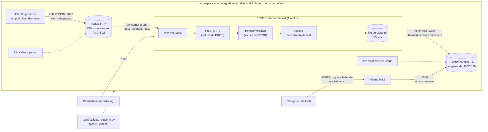

# Environnement de test EDOT : Kafka → EDOT Collector → Elasticsearch

Environnement **temporaire et jetable** qui valide de bout en bout la chaîne
d'ingestion de [`infra/edot-collector`](../edot-collector/README.md) **dans le
cluster**, sans aucun serveur externe :

- un **Kafka 4.3.2 mono-broker** (KRaft, sans ZooKeeper) ;
- un **Elasticsearch 9.5.6 mono-nœud** ;
- un **Kibana 9.5.6** pour consulter les logs indexés, joignable sur le tailnet
  (profil Kubernetes : `https://edot-kibana.tail0903df.ts.net`) ;
- une **instance EDOT Collector de test**, déployée avec le chart et les values
  **de production** (filtres OTTL compris), plus une surcharge de test ;
- un **producteur OTLP JSON** et un **test automatisé** qui vérifie les vrais
  documents indexés.

> [!WARNING]
> Environnement de **test uniquement** : pas de haute disponibilité, Kafka sans
> authentification, Elasticsearch sans TLS (mais avec authentification), aucun
> réplica. Rien ici ne doit être réutilisé en production. L'instance EDOT de
> production (namespace `edot`, release `edot-collector`) n'est **jamais**
> modifiée.

| | |
|---|---|
| Namespace | `edot-integration-test` (tout y est, rien ailleurs) |
| Kafka | `apache/kafka:4.3.2` — `kafka.edot-integration-test.svc.cluster.local:9092` |
| Elasticsearch | `docker.elastic.co/elasticsearch/elasticsearch:9.5.6` — `http://elasticsearch.edot-integration-test.svc.cluster.local:9200` |
| Kibana | `docker.elastic.co/kibana/kibana:9.5.6` — `https://edot-kibana.tail0903df.ts.net` (tailnet, profil Kubernetes) ; §5.5 |
| EDOT | `elastic-otel-collector:9.5.6`, chart `opentelemetry-collector` 0.178.3, release `edot-collector-test` |
| Topic | `otlp-logs-test` — 3 partitions, RF 1, rétention 6 h |
| Consumer group | `edot-integration-test` |
| Data stream | `logs-edotintegration.otel-test` (mapping natif OTel) |
| Argo CD | [`argocd/applications/infra/edot-integration-test.yaml`](../../argocd/applications/infra/edot-integration-test.yaml) — **sync manuelle** |
| Résultats de validation | [`VALIDATION.md`](VALIDATION.md) |

## Sommaire

1. [Démarrage rapide](#1-démarrage-rapide)
2. [Architecture](#2-architecture)
3. [Choix techniques et versions](#3-choix-techniques-et-versions)
4. [Kafka](#4-kafka)
5. [Elasticsearch et sécurité](#5-elasticsearch-et-sécurité)
6. [Connexion EDOT](#6-connexion-edot)
7. [Générer des logs](#7-générer-des-logs)
8. [Tests automatisés](#8-tests-automatisés)
9. [Supervision des ressources](#9-supervision-des-ressources)
10. [Modifier requests et limits](#10-modifier-requests-et-limits)
11. [Nettoyage](#11-nettoyage)
12. [Particularités OpenShift](#12-particularités-openshift)
13. [Limites du mono-nœud](#13-limites-du-mono-nœud)
14. [Arborescence](#14-arborescence)

---

## 1. Démarrage rapide

Prérequis sur le poste : `kubectl` (ou `oc`), `helm` 3, `python3` ≥ 3.9
(bibliothèque standard uniquement), un contexte pointant sur le cluster de test.

```bash
cd infra/edot-integration-test

scripts/deploy.sh          # Kafka, topic, Elasticsearch, utilisateur, EDOT de test
scripts/check-health.sh    # état, CPU/mémoire, disque
scripts/run-tests.sh       # test de bout en bout (code de sortie ≠ 0 si échec)
scripts/produce.sh --events info,nested --count 20 --interval 0.5   # logs à la demande
scripts/cleanup.sh         # supprime les workloads (PVC conservés)
scripts/cleanup.sh --delete-namespace   # tout, après confirmation
```

Chaque script affiche le contexte actif et **demande confirmation** avant d'agir.
En non-interactif : `--yes`, ou `EDOT_TEST_CONTEXT=<contexte attendu>` (le script
refuse alors tout autre contexte). Le profil plateforme (`kubernetes` ou
`openshift`) est détecté (API des SCC) ou forcé par `PLATFORM=…`.

> Premier déploiement : compter **jusqu'à 15–20 min** si les images ne sont pas
> encore sur les nœuds (Elasticsearch ~900 Mo). Les suivants : 2–3 min.

## 2. Architecture



- Tout passe par les **Services ClusterIP** internes ; ni Route, ni NodePort, ni
  LoadBalancer, ni IP externe. Seule exception : **Kibana**, exposé sur le
  **tailnet** par un Ingress de classe `tailscale` (profil Kubernetes, §5.5),
  jamais sur Internet ni sur le LAN.
- **NetworkPolicies** ([`base/network-policies`](base/network-policies)) : tout est
  refusé, puis seuls les pods étiquetés `edot-integration-test/kafka-client=true`
  joignent Kafka:9092 et ceux étiquetés `edot-integration-test/elasticsearch-client=true`
  joignent Elasticsearch:9200 (dont Kibana) ; Kibana:5601 n'est joint que par le
  Job `kibana-setup` et le proxy Tailscale de son Ingress. Prometheus (`monitoring`,
  `openshift-user-workload-monitoring`) joint EDOT:8888. DNS autorisé.
- Aucun objet **cluster-wide** (ni CRD, ni Operator, ni ClusterRole, ni SCC).

## 3. Choix techniques et versions

| Sujet | Choix | Raison |
|---|---|---|
| Operator Kafka / ECK | **aucun** | aucun n'est installé dans le cluster (vérifié) ; un Operator cluster-wide pour un test serait disproportionné |
| Packaging Kafka / ES | **Kustomize** (StatefulSet + Services + Jobs), comme les autres composants du dépôt | aucun chart officiel maintenu : les charts Bitnami ne sont plus publiés librement, le chart Helm Elastic est archivé au profit d'ECK ; quelques manifests lisibles sont plus simples |
| Kafka | `apache/kafka:4.3.2` (image officielle Apache, digest épinglé) | dernière 4.3 disponible, KRaft natif (ZooKeeper retiré depuis Kafka 4.0) |
| Elasticsearch | `elasticsearch:9.5.6` (image officielle Elastic, digest épinglé) | même version que l'EDOT 9.5.6 ; templates `logs-*.otel-*` intégrés |
| Kibana | `kibana:9.5.6` (image officielle Elastic, digest épinglé), Deployment sans PVC | même version qu'Elasticsearch (obligatoire) ; tout son état est dans Elasticsearch |
| EDOT | chart et values de **production** + [`edot/values-test.yaml`](edot/values-test.yaml) | teste exactement les filtres OTTL de production |
| Stockage | `local-path` (profil Kubernetes) | `longhorn`, classe par défaut, réplique chaque volume **3 fois** : inutile pour des données jetables |
| Secrets | Secret généré **hors Git** par `scripts/create-secrets.sh` | environnement jetable, sans dépendance à Vault ; la production d'EDOT reste sur Vault + ESO |
| Producteur | Python **bibliothèque standard** + `kafka-console-producer.sh` | aucune image à construire ni registre à alimenter |

Images (tag + digest, vérifiés sur le registre) :

```text
apache/kafka:4.3.2@sha256:852a0d49fc4e656b022e7f23785411802c9a088c78a7c5e39f33969de9c227a7
docker.elastic.co/elasticsearch/elasticsearch:9.5.6@sha256:79b4f1de4c15e6eca824723086a51e5934406d614d410cc11be77748cafac537
docker.elastic.co/elastic-agent/elastic-otel-collector:9.5.6        (infra/edot-collector/values.yaml)
docker.elastic.co/kibana/kibana:9.5.6@sha256:c7ed45da5c3cfea020fc6c99ce027f4d21d19dab330379c5115d5eb95f6ecebc
python:3.12.15-slim@sha256:a0f57064cbdcd6285fa45f51237ab0b35ea8ebaed06a1f5973e89e19dfb86704   (Job producteur)
```

### Ressources consommées

| Composant | Requests | Limits | Heap JVM | PVC |
|---|---|---|---|---|
| Kafka | 100m / 512Mi | 1 / 1Gi | 256–512 Mio | 5 Gi |
| Elasticsearch | 250m / 1Gi | 2 / 2Gi | 1 Gio | 5 Gi |
| EDOT de test | 100m / 256Mi | 1 / 512Mi | — (GOMEMLIMIT 80 %) | 1 Gi |
| Kibana | 100m / 768Mi | 1 / 1536Mi | 768 Mio (tas Node.js) | — |
| Jobs (ponctuels) | 10–50m / 16–192Mi | ≤ 500m / 384Mi | 128 Mio (outils Kafka) | — |

Consommation mesurée : [`VALIDATION.md`](VALIDATION.md).

## 4. Kafka

Fichiers : [`base/kafka`](base/kafka).

### 4.1 Mode KRaft mono-nœud

[`server.properties`](base/kafka/server.properties) : `process.roles=broker,controller`,
`node.id=1`, quorum statique d'un votant (`controller.quorum.voters=1@localhost:9093`),
listener `CONTROLLER` **sur la boucle locale uniquement**, tous les facteurs de
réplication à 1, `auto.create.topics.enable=false`.

Le conteneur formate le stockage KRaft (`kafka-storage.sh format --ignore-formatted`,
sans effet au redémarrage) puis lance `kafka-server-start.sh` avec ce fichier. Le
*wrapper* Docker de l'image n'est **pas** utilisé : il réécrit `/opt/kafka/config`,
non inscriptible avec un UID arbitraire OpenShift ou un rootfs en lecture seule.

### 4.2 Listeners

| Listener | Adresse d'écoute | Adresse annoncée |
|---|---|---|
| `PLAINTEXT` (clients) | `:9092` (toutes interfaces du pod) | `kafka.edot-integration-test.svc.cluster.local:9092` |
| `CONTROLLER` | `localhost:9093` | — |

Un seul broker : le Service ClusterIP `kafka` sert à la fois au bootstrap et
d'adresse annoncée. `enableServiceLinks: false` évite que Kubernetes injecte
`KAFKA_PORT=tcp://…` (interprété par les scripts Kafka).

### 4.3 Topic `otlp-logs-test`

Créé par le Job [`kafka-topic-init`](base/kafka/topic-job.yaml) (hook `PostSync`
Argo CD, relancé par `deploy.sh`), **idempotent** :
création `--if-not-exists`, rétention et `cleanup.policy` réappliquées, partitions
**augmentées** si demandé (Kafka ne sait pas les réduire : avertissement).

Paramètres : [`base/kafka/kustomization.yaml`](base/kafka/kustomization.yaml)

```yaml
      - TOPIC_PARTITIONS=3
      - TOPIC_RETENTION_MS=21600000   # 6 h
```

puis `scripts/deploy.sh`. Vérification : `scripts/run-tests.sh` affiche partitions,
RF et rétention ; à la main :

```bash
kubectl -n edot-integration-test logs job/kafka-topic-init
```

### 4.4 JVM et mémoire

`KAFKA_HEAP_OPTS="-Xms256m -Xmx512m"` pour une limite de 1 Gi : le reste couvre
metaspace, threads, buffers réseau et le cache de pages. 1 Gi suffit (mesure
dans [`VALIDATION.md`](VALIDATION.md)) ; il n'a pas été nécessaire de l'augmenter.

Les outils Kafka (topics, consumer groups) ne sont **jamais** lancés dans le pod du
broker (une seconde JVM y dépasserait la limite) : ils tournent dans les Jobs ou
dans le pod client éphémère des tests.

## 5. Elasticsearch et sécurité

Fichiers : [`base/elasticsearch`](base/elasticsearch).

### 5.1 Configuration

[`elasticsearch.yml`](base/elasticsearch/elasticsearch.yml) :

| Paramètre | Valeur | Pourquoi |
|---|---|---|
| `discovery.type` | `single-node` | un seul nœud, pas d'élection |
| `node.store.allow_mmap` | `false` | démarre même si `vm.max_map_count` est bas, **sans** DaemonSet privilégié ni modification des workers (sur le cluster du dépôt il vaut déjà 1048576) |
| `xpack.security.enabled` | `true` | **authentification obligatoire** |
| `xpack.security.http.ssl.enabled` | `false` | pas de CA à distribuer (voir 5.3) |
| `xpack.ml.enabled`, `xpack.watcher.enabled` | `false` | inutiles, mémoire et CPU |
| `ingest.geoip.downloader.enabled` | `false` | aucun accès Internet nécessaire |
| Heap | `ES_JAVA_OPTS=-Xms1g -Xmx1g` | ≤ 50 % de la limite de 2 Gi |
| Réplicas | `0` (component template `logs-otel@custom`) | un réplica ne serait jamais alloué sur un nœud unique (cluster `yellow`) |

Le point d'entrée de l'image écrit dans `config/` (keystore du mot de passe
`elastic`) : un initContainer recopie la configuration de l'image et celle du
dépôt dans un `emptyDir`, ce qui permet un **rootfs en lecture seule**.

### 5.2 Identifiants

Secret **`elasticsearch-test-credentials`**, créé par `scripts/create-secrets.sh`
avec des valeurs **aléatoires** (32 caractères), **jamais dans Git, jamais
affichées** ; dans un Secret existant, seules les clés **absentes** sont ajoutées
(cas d'un Secret créé avant l'ajout de Kibana), aucune valeur n'est modifiée.

| Clé | Usage |
|---|---|
| `elastic-password` | superutilisateur `elastic` : Job de setup, tests, consultation |
| `edot-username` / `edot-password` | utilisateur `edot-integration-test` de l'EDOT de test |
| `kibana-system-password` | utilisateur intégré `kibana_system` (connexion Kibana → Elasticsearch) |
| `kibana-encryption-key` | clé de chiffrement de Kibana (48 caractères : sessions, objets enregistrés chiffrés) |

Le Job [`elasticsearch-setup`](base/elasticsearch/setup.sh) crée le rôle
`edot_integration_test_writer` avec les **mêmes privilèges minimaux** que l'API Key
de production (`monitor` ; `auto_configure` + `create_doc` sur `logs-*.otel-*`) et
l'utilisateur EDOT associé.

Rotation : supprimer le Secret, relancer `scripts/deploy.sh` (nouveau Secret, le
Job de setup réinitialise l'utilisateur EDOT ; `elastic` prend le nouveau mot de
passe au redémarrage d'Elasticsearch, son keystore étant régénéré à chaque démarrage).

### 5.3 Sécurité réduite : périmètre et compensations

| Réduction | Limitée à | Compensation |
|---|---|---|
| Kafka `PLAINTEXT` sans SASL | ce namespace | NetworkPolicies : seuls les pods `kafka-client` joignent :9092 ; Service ClusterIP seulement |
| Elasticsearch HTTP sans TLS | ce namespace | authentification active ; NetworkPolicies : seuls les pods `elasticsearch-client` joignent :9200 |
| `tls: null` / `auth: null` / `api_key: null` dans EDOT | [`edot/values-test.yaml`](edot/values-test.yaml), référencé **uniquement** par l'Application de test et `deploy.sh` | les values de production (TLS vérifié, SASL_SSL, API Key) ne sont pas modifiées |

Ne pas supprimer les NetworkPolicies, ne jamais copier ces réglages en production.

### 5.5 Kibana

Fichiers : [`base/kibana`](base/kibana) ; exposition :
[`overlays/kubernetes/tailscale`](overlays/kubernetes/tailscale).

| | |
|---|---|
| URL | **`https://edot-kibana.tail0903df.ts.net`** — tailnet uniquement, certificat géré par Tailscale |
| Connexion | utilisateur **`elastic`**, mot de passe : clé `elastic-password` du Secret (ci-dessous) |
| Vue de données par défaut | **« Logs EDOT (OTel) »** sur `logs-*.otel-*`, champ de temps `@timestamp` (Job `kibana-setup`) |
| Hors tailnet | `kubectl -n edot-integration-test port-forward svc/kibana 5601`, puis `http://localhost:5601` |

```bash
# Mot de passe d'elastic, à saisir dans le formulaire de connexion (ne pas le coller ailleurs)
kubectl -n edot-integration-test get secret elasticsearch-test-credentials \
  -o jsonpath='{.data.elastic-password}' | base64 -d; echo
```

Consulter les logs : **Discover** → vue « Logs EDOT (OTel) » ; filtrer par
exemple sur `attributes.test.campaign_id : "e2e-…"` (identifiant affiché par
`scripts/run-tests.sh`) ou `resource.attributes.service.name : "application-test"`.
Les documents filtrés par EDOT (DEBUG, healthchecks, service exclu) n'y
figurent pas, et les champs supprimés (`user.email`, `client.ip`…) sont absents.

Fonctionnement :

- **initContainer** `kibana-system-password` : fixe (idempotent) le mot de passe
  de `kibana_system` avec le compte `elastic`. Il est dans le pod, et non dans
  un Job, parce qu'Argo CD attend que Kibana soit sain avant d'exécuter les
  hooks `PostSync`.
- **Kibana** ne reçoit que `kibana_system` ; les personnes se connectent avec
  leur compte Elasticsearch.
- Rootfs en lecture seule (données, journaux, `/tmp` en `emptyDir`), aucune
  capability, Pod Security `restricted`. Aucune sortie Internet : télémétrie,
  actualités, cartes Elastic et registre Fleet désactivés
  ([`kibana.yml`](base/kibana/kibana.yml)), sorties refusées par les NetworkPolicies.
- Cookies de session `Secure` et `server.publicBaseUrl` alignés sur l'URL du
  tailnet (overlay Kubernetes). Le port-forward reste utilisable par
  `http://localhost` (contexte sûr pour les navigateurs).
- Aucun PVC : vues, tableaux de bord et sessions sont stockés dans les index
  système d'Elasticsearch (`.kibana*`).

Avertissements attendus dans les journaux, sans conséquence : absence de TLS
(HTTP interne au cluster), bac à sable Chromium (rapports PDF), fonctions
réservées aux licences payantes (assistant IA).

### 5.4 Argo CD

Alternative à `deploy.sh` (l'un **ou** l'autre ; `deploy.sh` refuse de s'exécuter
si l'Application existe) :

```bash
infra/edot-integration-test/scripts/create-secrets.sh   # après création du namespace, voir ci-dessous
kubectl apply -f argocd/applications/infra/edot-integration-test.yaml
argocd app sync edot-integration-test                    # synchronisation MANUELLE
```

Le namespace est créé par la sync (`CreateNamespace`) : pour créer le Secret avant,
`kubectl create namespace edot-integration-test` d'abord (labels posés ensuite par
Argo CD). La synchronisation est **manuelle** (aucun bloc `automated`) et
l'Application n'est intégrée à aucune synchronisation automatique. Elle suit
`main` : la fusionner avant de l'utiliser. Les Jobs sont des hooks `PostSync`.

## 6. Connexion EDOT

L'instance de test (release Helm **`edot-collector-test`**) empile :

```text
infra/edot-collector/values.yaml                (production, inchangé)
infra/edot-collector/values-kubernetes.yaml     (ou values-openshift.yaml)
infra/edot-collector/values-kafka.yaml          (production, inchangé)
infra/edot-collector/values-elasticsearch.yaml  (production, inchangé)
infra/edot-collector/values-processing.yaml     (FILTRES OTTL DE PRODUCTION)
infra/edot-integration-test/edot/values-test.yaml
infra/edot-integration-test/edot/values-test-kubernetes.yaml  (profil Kubernetes : local-path)
```

`values-test.yaml` ne redéfinit **aucun** filtre ni aucune suppression : il ne
change que la connexion et le dimensionnement.

| Paramètre | Production | Test |
|---|---|---|
| Brokers | `TODO_KAFKA_BROKER_n` (SASL_SSL) | `kafka.edot-integration-test.svc.cluster.local:9092`, `tls: null`, `auth: null` |
| Consumer group | `TODO_KAFKA_CONSUMER_GROUP` | `edot-integration-test` |
| `initial_offset` | `latest` | `earliest` (aucun message perdu avant l'arrivée du Collector) |
| Elasticsearch | `https://TODO…`, API Key, CA | `http://elasticsearch.edot-integration-test.svc.cluster.local:9200`, `user`/`password` |
| Data stream | `logs-TODO.otel-TODO` | `logs-edotintegration.otel-test` |
| `flush_timeout` | 5 s | 1 s (résultats rapides) |
| Réplicas / PVC / mémoire | 2 / 10 Gi / 3 Gi | 1 / 1 Gi / 512 Mi |

Pipeline (de production) : `kafka` → `memory_limiter` → `filter/severity` →
`filter/resource` → `filter/log-attributes` → `filter/values` →
`transform/redact` → `transform/routing` → `elasticsearch` (mapping `otel`).

Modifier une règle OTTL : éditer `infra/edot-collector/values-processing.yaml`,
`scripts/deploy.sh` (redémarre l'EDOT de test), `scripts/run-tests.sh`.

## 7. Générer des logs

[`producer/produce_otlp.py`](producer/produce_otlp.py) génère de vrais messages
`ExportLogsServiceRequest` OTLP/JSON (`resourceLogs → resource / scopeLogs →
logRecords`), un par message Kafka.

| Type (`--events`) | Contenu | Attendu dans Elasticsearch |
|---|---|---|
| `info` | `service.name=application-test`, INFO, « Test OpenTelemetry », `user.email`, `client.ip`, `debug.payload` | indexé, les 3 attributs sensibles **absents** |
| `debug` | DEBUG, « Debug event » | **absent** (`filter/severity`) |
| `health` | `http.route=/health` | **absent** (`filter/log-attributes`) |
| `excluded` | `service.name=excluded-service` | **absent** (`filter/resource`) |
| `normal` | WARN, attributs HTTP ordinaires | indexé **inchangé** |
| `nested` | Body objet : `user.{id,email,name}`, `order.{…}`, `message` | indexé, `body.structured.user.email` **absent**, le reste conservé |
| `witness` | témoin de fin de campagne (ajouté automatiquement) | indexé |

Chaque enregistrement porte `test.campaign_id`, `test.case`, `test.seq`. La clé
Kafka est l'identifiant de campagne : une campagne entière va dans **une seule
partition**, donc est consommée dans l'ordre.

**Job Kubernetes** (images officielles, aucune construction) :

```bash
scripts/produce.sh                                          # 6 événements + témoin
scripts/produce.sh --events info,normal --count 100 --interval 0.1 --campaign-id charge-01
```

Paramètres : broker et topic (ConfigMap `otlp-producer-config` de
[`producer/kustomization.yaml`](producer/kustomization.yaml)), types, nombre de
tours, intervalle, identifiant de campagne. Le Job réunit un conteneur Python
(générateur) et un conteneur Kafka (`kafka-console-producer.sh`) reliés par une FIFO.

**Sans Job** (générateur seul, sortie `clé<TAB>message`) :

```bash
python3 producer/produce_otlp.py --events all --campaign-id demo | head -1
```

**Consulter les documents** (depuis le poste, par port-forward) :

```bash
NS=edot-integration-test
kubectl -n $NS port-forward svc/elasticsearch 9200:9200 &
PASS="$(kubectl -n $NS get secret elasticsearch-test-credentials -o jsonpath='{.data.elastic-password}' | base64 -d)"
curl -s -u "elastic:$PASS" "http://127.0.0.1:9200/logs-edotintegration.otel-test/_search?pretty" \
  -H 'Content-Type: application/json' \
  -d '{"query":{"term":{"attributes.test.campaign_id":"charge-01"}},"size":5}'
curl -s -u "elastic:$PASS" "http://127.0.0.1:9200/_cat/indices/.ds-logs-*?v"
```

## 8. Tests automatisés

```bash
scripts/run-tests.sh                 # = python3 tests/validate_pipeline.py
scripts/run-tests.sh --timeout 300 --settle 10
```

[`tests/validate_pipeline.py`](tests/validate_pipeline.py), bibliothèque standard
uniquement, accès au cluster par `kubectl`/`oc` :

1. **Préconditions** : broker prêt et joignable **par son Service** (pod client
   éphémère soumis aux NetworkPolicies) ; topic présent (partitions, RF,
   rétention) ; Elasticsearch `green`/`yellow`, 1 nœud ; EDOT prêt **et membre
   du consumer group**.
2. **Publication** des 6 événements + témoin, même partition.
3. **Attente** (timeout `--timeout`, 180 s) : événements attendus et témoin
   indexés ; **lag du consumer group nul** ; stabilisation `--settle` (5 s, >
   `flush_timeout`) et `_refresh`.
4. **Assertions sur les documents Elasticsearch** de la campagne.

Une absence n'est comptée « filtrée » **que si** le témoin, publié après, est
indexé et que le lag est nul : sinon l'assertion échoue « NON VÉRIFIABLE ».

```text
=========================================
          EDOT INTEGRATION TEST
=========================================
Kafka connection             OK
Kafka topic                  OK
Elasticsearch connection     OK
EDOT Collector               OK

INFO log indexed             PASS
DEBUG log filtered           PASS
Healthcheck filtered         PASS
Excluded service filtered    PASS
user.email removed           PASS
client.ip removed            PASS
debug.payload removed        PASS
Normal log kept unchanged    PASS
Nested field removed         PASS
Nested siblings kept         PASS
OTel native mapping          PASS
=========================================
       RESULT: 11/11 TESTS PASSED
=========================================
```

Codes de sortie : `0` succès, `1` test en échec, `2` préconditions non remplies.
Les compteurs internes d'EDOT (`otelcol_processor_filter_logs_filtered` par
filtre) se consultent dans Prometheus (§9) : le port 8888 écoute sur l'IP du pod,
hors de portée d'un `kubectl port-forward`.

## 9. Supervision des ressources

Dashboard Grafana **« EDOT Collector — Kafka → Elasticsearch »** (celui de la
production, publié par l'overlay kubernetes) : choisir
`Namespace = edot-integration-test` en haut du dashboard. Panneaux vides
attendus : volume des PVC (`local-path` ne publie pas `kubelet_volume_stats_*`)
et compteurs d'erreurs (ils n'apparaissent qu'au premier incident).

Aucun Prometheus ni Grafana supplémentaire. Ce qui existe déjà suffit :

- **CPU / mémoire** de chaque pod : metrics-server (`kubectl top`) et cAdvisor
  (Prometheus de `kube-prometheus-stack`), sans exporter ajouté ;
- **disque des PVC** : `scripts/check-health.sh` (taille réelle par `du`).
  Avec **`local-path`**, le volume est un répertoire de l'hôte **sans quota** :
  les 5 Gi demandés ne sont pas une limite dure, `df` affiche le disque du nœud
  et le kubelet ne publie **pas** `kubelet_volume_stats_*` (vérifié). Ces
  métriques existent avec une StorageClass CSI (longhorn, classes OpenShift) ;
- **EDOT** : ServiceMonitor du chart (label `release: kube-prometheus-stack`,
  découvert par le Prometheus du namespace `monitoring`) ; le dashboard
  « EDOT Collector » existant ([`infra/edot-collector/dashboards`](../edot-collector/dashboards))
  s'utilise en filtrant le namespace `edot-integration-test`.

```bash
scripts/check-health.sh                                         # synthèse
kubectl top pods -n edot-integration-test --containers
kubectl top pods -n edot-integration-test -l app.kubernetes.io/name=kafka
kubectl top pods -n edot-integration-test -l app.kubernetes.io/name=elasticsearch
kubectl top pods -n edot-integration-test -l app.kubernetes.io/instance=edot-collector-test
kubectl get pvc -n edot-integration-test
# OpenShift : mêmes commandes avec oc
oc adm top pods -n edot-integration-test --containers
oc get pvc -n edot-integration-test
```

Requêtes PromQL (Grafana → Explore) :

```promql
# Mémoire (working set) par composant
sum by (pod) (container_memory_working_set_bytes{namespace="edot-integration-test", container!="", container!="POD"})
# Ratio mémoire / limite
sum by (pod) (container_memory_working_set_bytes{namespace="edot-integration-test", container!=""})
  / sum by (pod) (kube_pod_container_resource_limits{namespace="edot-integration-test", resource="memory"})
# CPU (cœurs)
sum by (pod) (rate(container_cpu_usage_seconds_total{namespace="edot-integration-test", container!=""}[5m]))
# Throttling CPU
sum by (pod) (rate(container_cpu_cfs_throttled_periods_total{namespace="edot-integration-test"}[5m]))
  / sum by (pod) (rate(container_cpu_cfs_periods_total{namespace="edot-integration-test"}[5m]))
# Disque des PVC (StorageClass CSI uniquement ; rien avec local-path)
kubelet_volume_stats_used_bytes{namespace="edot-integration-test"} / kubelet_volume_stats_capacity_bytes{namespace="edot-integration-test"}
# Redémarrages / OOMKilled
kube_pod_container_status_restarts_total{namespace="edot-integration-test"}
kube_pod_container_status_last_terminated_reason{namespace="edot-integration-test", reason="OOMKilled"}
# EDOT : lag Kafka, logs supprimés par filtre, documents indexés
sum(otelcol_kafka_receiver_offset_lag{namespace="edot-integration-test"})
#   Prometheus 3 (noms UTF-8) stocke ce compteur AVEC un point : sélecteur __name__.
sum by (filter) ({__name__="otelcol_processor_filter_logs.filtered", namespace="edot-integration-test"})
sum by (outcome) (rate(otelcol_elasticsearch_docs_processed{namespace="edot-integration-test"}[5m]))
```

Labels pour filtrer : `app.kubernetes.io/part-of=edot-integration-test` (tout),
`app.kubernetes.io/name=kafka|elasticsearch`, `app.kubernetes.io/instance=edot-collector-test`.

## 10. Modifier requests et limits

| Composant | Fichier | Règle |
|---|---|---|
| Kafka | [`base/kafka/statefulset.yaml`](base/kafka/statefulset.yaml) : `resources` **et** `KAFKA_HEAP_OPTS` | `-Xmx` ≈ 50 % de `limits.memory` |
| Elasticsearch | [`base/elasticsearch/statefulset.yaml`](base/elasticsearch/statefulset.yaml) : `resources` **et** `ES_JAVA_OPTS` | `-Xms` = `-Xmx` ≤ 50 % de `limits.memory` |
| EDOT de test | [`edot/values-test.yaml`](edot/values-test.yaml) : `resources` | GOMEMLIMIT (80 %) et `memory_limiter` (75 %) suivent automatiquement |

Exemple, Elasticsearch à 3 Gi :

```yaml
            - name: ES_JAVA_OPTS
              value: "-Xms1536m -Xmx1536m"
          resources:
            limits:
              memory: 3Gi
```

puis `scripts/deploy.sh` (redémarrage du pod ; données conservées). Signes d'une
limite trop basse : `OOMKilled` dans `kubectl describe pod`, redémarrages, ratio
mémoire/limite > 90 %. Agrandir un PVC : `local-path` ne permet pas l'expansion,
supprimer et recréer (`cleanup.sh --delete-pvc`, données de test perdues).

## 11. Nettoyage

```bash
scripts/cleanup.sh                     # workloads ; PVC, Secret et namespace conservés
scripts/cleanup.sh --delete-pvc        # + PVC et Secret (confirmation)
scripts/cleanup.sh --delete-namespace  # + namespace (confirmation)
```

Le script n'agit que dans `edot-integration-test` (garde-fou sur le nom) ; il ne
touche à aucun Operator, CRD ou objet cluster-wide. Suppression de la release
`edot-collector-test`, des objets Kustomize, du Job producteur et des pods clients.

Ressources qui **subsistent** sans option :

| Ressource | Pourquoi | Suppression |
|---|---|---|
| PVC `data-kafka-0`, `data-elasticsearch-0`, `queue-edot-collector-test-0` | `persistentVolumeClaimRetentionPolicy: Retain` | `--delete-pvc` |
| PV `local-path` associés | supprimés par le provisioner avec leur PVC (`reclaimPolicy: Delete`) | automatique |
| Secret `elasticsearch-test-credentials` | hors Kustomize | `--delete-pvc` |
| Namespace | conservé | `--delete-namespace` |
| Application Argo CD (si utilisée) | — | `kubectl -n argocd delete application edot-integration-test` |
| Ingress Tailscale `edot-kibana-tailscale` | supprimé avec les objets Kustomize ; l'appareil `edot-kibana` disparaît du tailnet | automatique |
| Images sur les nœuds | cache containerd | ramasse-miettes du kubelet |

## 12. Particularités OpenShift

- Profil `overlays/openshift` (détecté automatiquement) : **aucun** `runAsUser`,
  `runAsGroup` ni `fsGroup` ; la SCC **`restricted-v2`** attribue l'UID et le
  fsGroup. Aucune SCC personnalisée, aucun RoleBinding, aucun conteneur root,
  aucun initContainer `chown`.
- Images vérifiées avec un UID arbitraire (`1000680000`), GID 0, rootfs en lecture
  seule, aucune capability (Kafka : wrapper Docker contourné, §4.1 ;
  Elasticsearch : `config/` en emptyDir, §5.1).
- `vm.max_map_count` : sans objet (`node.store.allow_mmap: false`) ; **aucun**
  DaemonSet privilégié, aucun `sysctl`.
- EDOT : `values-openshift.yaml` à la place de `values-kubernetes.yaml`, et **ne
  pas** appliquer `values-test-kubernetes.yaml` (fait par `deploy.sh`) ; dans
  l'Application Argo CD, remplacer l'overlay et ces fichiers (commentaires inline).
- StorageClass : celle par défaut, ou patch commenté dans
  [`overlays/openshift/kustomization.yaml`](overlays/openshift/kustomization.yaml) (TODO selon le cluster).
- Supervision : la supervision des projets utilisateur
  (`openshift-user-workload-monitoring`) découvre le ServiceMonitor ;
  NetworkPolicy d'entrée déjà prévue. `oc adm top pods` pour la consommation.
- OpenShift GitOps : ajouter `argocd.argoproj.io/managed-by: <namespace Argo CD>`
  dans `managedNamespaceMetadata` (comme pour l'Application de production).
- Aucune Route n'est créée ; ne pas en ajouter.
- **Non testé sur un cluster OpenShift réel** (aucun accessible) : voir
  [`VALIDATION.md`](VALIDATION.md).

## 13. Limites du mono-nœud

- **Aucune tolérance aux pannes** : perte du nœud → Kafka ou Elasticsearch
  indisponible. Avec `local-path`, le volume est **lié au nœud** : le pod ne
  peut pas être replanifié ailleurs tant que le nœud est absent.
- Pas de réplication Kafka (`acks=all` = 1 réplica), pas de réplica Elasticsearch :
  une corruption de volume perd les données (jetables).
- Débit et latence **non représentatifs** de la production ; aucun test de charge
  ne doit en tirer de dimensionnement.
- Sécurité réduite (§5.3) : pas de test de TLS, SASL ni API Key ici ; ces points
  sont couverts par le banc de [`infra/edot-collector/tests/functional`](../edot-collector/tests/functional).
- Un seul réplica EDOT : pas de test de rebalance du consumer group.
- Rétention Kafka 6 h et PVC de 5 Gi : des campagnes de charge prolongées peuvent
  remplir le disque. Avec `local-path`, **aucun quota** : c'est le disque du nœud
  qui se remplit (surveiller `scripts/check-health.sh`).

## 14. Arborescence

```text
infra/edot-integration-test/
├── README.md, VALIDATION.md
├── base/                         # commun aux deux plateformes
│   ├── kustomization.yaml        # namespace, labels communs
│   ├── kafka/                    # server.properties, StatefulSet, Services, Job topic
│   ├── elasticsearch/            # elasticsearch.yml, StatefulSet, Services, Job setup
│   ├── kibana/                   # kibana.yml, Deployment, Service, Job kibana-setup
│   └── network-policies/         # deny par défaut + flux autorisés
├── overlays/
│   ├── kubernetes/               # UID 10001, StorageClass local-path ; tailscale/ (Ingress Kibana) ; producer/
│   └── openshift/                # SCC restricted-v2 ; producer/
├── edot/
│   ├── values-test.yaml          # surcharge de test du chart EDOT
│   └── values-test-kubernetes.yaml
├── producer/                     # produce_otlp.py, Job, kustomization
├── tests/validate_pipeline.py    # test de bout en bout
└── scripts/                      # deploy, check-health, produce, run-tests, cleanup, create-secrets, lib
```
